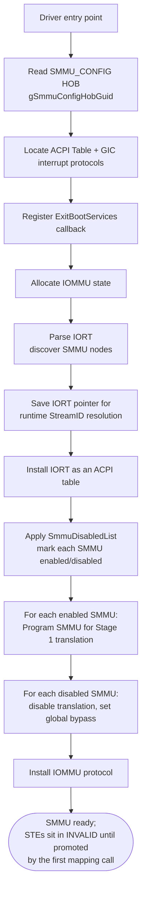
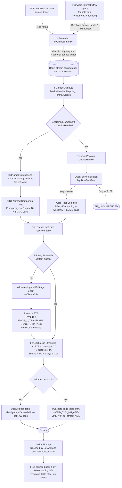

# SmmuDxe Driver

This document describes the System Memory Management Unit (SMMU) driver implementation, and how it integrates with the
DMA capable subsystem. The driver configures the SMMUv3 hardware and implements the IOMMU protocol to provide address
translation and memory protection for DMA operations.

## Architecture Overview

The SmmuDxe driver will consume the SMMU_CONFIG HOB with the IORT data to configure the SMMUs found on the platform.
It configures every enabled SMMU for Stage 1 translation, with per-stream Context Descriptors (CDs) and ASIDs.
SmmuDxe will install the IoMmu Protocol. Translation table mapping can be done by leveraging the IoMmu Protocol.
The protocol functions are outlined below. Seperatley, an IoMmuLib is provided for platforms to use as an
abstraction for locating and using the IoMmu protocol. SmmuDxe will install the IORT ACPI Table. Platform should
not install the IORT, but instead pass in the IORT data with the SMMU_CONFIG HOB.

The system consists of four main components working together:

1. **PCI I/O Protocol**: Provides interface for PCI / NonDiscoverable device access and DMA operations
2. **IortNamedComponent Protocol**: Installed by NonDiscoverable drivers and firmware-internal DMA agents on the handle
   they pass to `IoMmuSetAttribute`; names the IORT Named Component that describes the device
3. **IOMMU Protocol**: Implements DMA remapping and memory protection (`SetAttribute` entry point)
4. **SMMU Hardware Driver**: Configures and manages the SMMU hardware

## IOMMU Protocol Integration

1. **PCI / NonDiscoverable Driver Initiates DMA**:
   - Device driver calls `PciIo->Map()` / `PciIo->Unmap()`
   - SmmuDxe resolves the controller `EFI_HANDLE` -> IORT -> StreamID(s) + owning SMMU and programs the page table
     via `IoMmuSetAttribute`.

2. **Firmware-internal DMA Agent via DmaLib or IoMmuLib**:
   - Agents without a PCI handle create an `EFI_HANDLE`, install `gIortNamedComponentProtocolGuid` on it, and pass that
     handle to `IoMmuLib::IoMmuSetAttribute` directly or to `DmaMap()` from `EmbeddedPkg`'s `CoherentDmaLib` /
     `NonCoherentDmaLib`:

     ```c
     EFI_STATUS
     EFIAPI
     DmaMap (
       IN     DMA_MAP_OPERATION  Operation,
       IN     VOID               *HostAddress,
       IN OUT UINTN              *NumberOfBytes,
       IN     EFI_HANDLE         DeviceHandle, // NULL = no IOMMU programming
       OUT    PHYSICAL_ADDRESS   *DeviceAddress,
       OUT    VOID               **Mapping
       );
     ```

   - DmaLib calls `IoMmuMap` for bookkeeping, then forwards `DeviceHandle` to `IoMmuSetAttribute`.
   - **`DeviceHandle == NULL`** is the explicit "no DMA protection" opt-out: the IOMMU is not programmed and the
     caller's DMA goes through unmediated.

3. **IOMMU Protocol Setup**:
   - Implements the IOMMU protocol:

     ```c
     struct _EDKII_IOMMU_PROTOCOL {
       UINT64                         Revision;
       EDKII_IOMMU_SET_ATTRIBUTE      SetAttribute;
       EDKII_IOMMU_MAP                Map;
       EDKII_IOMMU_UNMAP              Unmap;
       EDKII_IOMMU_ALLOCATE_BUFFER    AllocateBuffer;
       EDKII_IOMMU_FREE_BUFFER        FreeBuffer;
     };
     ```

   - SmmuDxe will handle Translation Table initialization

## DMA Mapping with IoMmuLib and IoMmu Protocol

- Maintains up to a 4-level Stage 1 page table per stream to map HostAddress and DeviceAddress
- Identity Mapped

1. **IoMmu Map**:

   ```c
   EFI_STATUS
   EFIAPI
   IoMmuMap (
     IN     EDKII_IOMMU_OPERATION  Operation,
     IN     VOID                   *HostAddress,
     IN OUT UINTN                  *NumberOfBytes,
     OUT    EFI_PHYSICAL_ADDRESS   *DeviceAddress,
     OUT    VOID                   **Mapping
     );
   ```

- Maps HostAddress to DeviceAddress
- Validates operation type
- Called by PciIo protocol for mapping

### Bounce Buffering

In certain conditions, `IoMmuMap` will allocate a bounce buffer instead of using the original host address directly.
A bounce buffer is a temporary intermediate buffer that is used when the original DMA buffer
cannot be used directly by the device.

**Bounce Buffer Conditions:**

A bounce buffer is allocated when the operation is NOT `EdkiiIoMmuOperationBusMasterCommonBuffer` or
`EdkiiIoMmuOperationBusMasterCommonBuffer64`, AND any of the following conditions are met:

1. **Alignment Requirements Not Met:**
   - Alignment check for the start and end of the DMA buffer are needed so that we don't over-map
   a buffer in the page table. Page table mappings can only be done page-by-page.
   - The `NumberOfBytes` is not 4KB aligned, OR
   - The `HostAddress` (PhysicalAddress) is not 4KB aligned

2. **32-bit DMA Limitation:**
   - The operation is a 32-bit DMA operation (`EdkiiIoMmuOperationBusMasterRead` or
     `EdkiiIoMmuOperationBusMasterWrite`), AND
   - Any part of the DMA transfer range (`PhysicalAddress + NumberOfBytes`) exceeds 4GB

**Bounce Buffer Behavior:**

- When a bounce buffer is needed due to **alignment issues only** (with 64-bit operations), memory can be allocated
  anywhere in the address space
- When a bounce buffer is needed due to the **32-bit DMA limitation**, memory is allocated below 4GB using
  `AllocateMaxAddress` with `DmaMemoryTop` set to `SIZE_4GB - 1`
- The `DeviceAddress` returned points to the bounce buffer, not the original host address
- The `Mapping` handle stores information about both the original host address and the bounce buffer address

**CopyMem on Map (Host -> Bounce Buffer):**

A `CopyMem` from the host buffer to the bounce buffer is performed during `IoMmuMap` when:

- A bounce buffer was allocated (NeedRemap is TRUE), AND
- The operation is a **read operation** from the Bus Master's perspective:
  - `EdkiiIoMmuOperationBusMasterRead`, OR
  - `EdkiiIoMmuOperationBusMasterRead64`

This copy ensures the Bus Master can read the correct data from the bounce buffer during the DMA operation.
For write operations, no copy is needed on Map since the Bus Master will write new data into the bounce buffer.

## DMA Unmapping with IoMmuLib and IoMmu Protocol

1. **PCI Driver Completes DMA**:
   - Calls PciIo->Unmap()
   - Provides mapping handle

2. **IoMmu Unmap**:

   ```c
   EFI_STATUS
   EFIAPI
   IoMmuUnmap (
     IN  VOID                  *Mapping
     );
   ```

   - Only does bounce buffer cleanup.
   - Caller must call SetAttributes(0) before IoMmuUnmap to remove R|W attributes to effectivley unmap the page table.

### Bounce Buffer Handling on Unmap

When unmapping a DMA operation that used a bounce buffer (i.e., `DeviceAddress != HostAddress`):

**CopyMem on Unmap (Bounce Buffer -> Host):**

A `CopyMem` from the bounce buffer back to the host buffer is performed during `IoMmuUnmap` when:

- A bounce buffer was used (`DeviceAddress != HostAddress`), AND
- The operation is a **write operation** from the Bus Master's perspective:
  - `EdkiiIoMmuOperationBusMasterWrite`, OR
  - `EdkiiIoMmuOperationBusMasterWrite64`

This copy ensures the processor can access the data that the Bus Master wrote into the bounce buffer.
For read operations, no copy is needed on Unmap since the Bus Master only read data and did not modify it.

**Cleanup:**

- The bounce buffer pages are freed using `FreePages`
- The mapping information structure is freed

For direct mappings (no bounce buffer), only the mapping information structure is freed.

### DMA Access Attributes with IoMmuLib and IoMmu Protocol

1. Setting R/W permissions
   - After mapping an address with IoMmuMap()
   - Clearning R/W permissions before unmmapping an address with IoMmuUnmap()
   - Sets access permissions based on IoMmuAccess type:
     - When IoMmuAccess is not 0, R|W permissions are set.
     - When IoMmuAccess is 0, no read or write access is permitted.

2. IoMmu SetAttribute

   ```c
   EFI_STATUS
   EFIAPI
   IoMmuSetAttribute (
      IN EFI_HANDLE            DeviceHandle,
      IN VOID                  *Mapping,
      IN UINT64                IoMmuAccess
   );
   ```

   `SetAttribute` is the **worker** of the IOMMU protocol - `IoMmuMap` only allocates the `IOMMU_MAP_INFO`
   bookkeeping (and a bounce buffer if needed); it does **not** touch the SMMU page tables. All real page-table
   mutation happens here, on the `SetAttribute` call that follows `Map` (and on the `SetAttribute(..., 0)` that
   precedes `Unmap`).

   The `EFI_HANDLE DeviceHandle` parameter is how SmmuDxe knows *which* device (and therefore which StreamID(s) and
   which SMMU) to program:

   1. `gBS->HandleProtocol (DeviceHandle, &gIortNamedComponentProtocolGuid, ...)` - if the handle carries the
      `IORT_NAMED_COMPONENT_PROTOCOL`, SmmuDxe calls `GetDeviceObjectName()` and walks the IORT for the Named
      Component node with that `ObjectName` (see
      [Non-Discoverable Device Integration](#non-discoverable-device-integration)).
   2. Otherwise `gBS->HandleProtocol (DeviceHandle, &gEfiPciIoProtocolGuid, ...)` retrieves the
      `EFI_PCI_IO_PROTOCOL` installed by `PciBusDxe`, and `PciIo->GetLocation (&Seg, &Bus, &Dev, &Func)` returns the
      BDF that is resolved through the IORT Root-Complex ID-mapping path. A NonDiscoverable `PciIo` (Segment `0xFF`)
      without `IortNamedComponent` is rejected with `EFI_UNSUPPORTED`.
   3. The resolved primary StreamID's per-stream Stage 1 page-table root and ASID, stored in its Context
      Descriptor, are then used to actually install / invalidate the mapping for
      `MapInfo->DeviceAddress` with the requested `IoMmuAccess` permissions (or to tear it down when
      `IoMmuAccess == 0`).

   This is also why the controller handle had to be plumbed through `NonDiscoverablePciDeviceDxe` - its
   `PciIoMap`/`PciIoUnmap` now pass `Dev->Handle` to `IoMmuSetAttribute` instead of the old `NULL`, so SmmuDxe can do
   the resolution above for non-discoverable devices the same way it does for real PCIe.

## Per-StreamID Isolation

Each DMA-capable device gets its own per-stream Stage 1 page-table root and **ASID**, stored in a per-stream
Context Descriptor (CD) whose address the STE's `S1ContextPtr` field points at. Mappings made for one device are
**not** visible to any other device. Conceptually, on every `IoMmuSetAttribute` call the driver:

1. Resolves the device handle to:
   - One or more StreamIDs.
   - The base address of the SMMU node that owns them.

   This resolution walks the platform IORT, using the `IortNamedComponent` protocol on the handle when present (see
   [Non-Discoverable Device Integration](#non-discoverable-device-integration)). The result is cached on first
   lookup - Named Component `ObjectName` -> (SMMU base, StreamIDs), and PCIe (Segment, RID range of the matched RC ID
   mapping) -> (SMMU base, StreamID base) - so later `SetAttribute` calls for the same stream skip the IORT walk.
2. Selects the matching SMMU instance by that base address.
3. For the **primary** (first) StreamID, lazily allocates a single 4KB Stage 1 page-table root, a Context Descriptor,
   and an ASID (the CD's `Ttb0` points at the root, `Asid` holds the tag). It then promotes the Stream Table Entry
   (STE) from `INVALID` to `STAGE_1_TRANSLATE / STAGE_2_BYPASS` with `S1ContextPtr` pointing at the CD
   (break-before-make).
4. Aliases every additional StreamID reported for the same device onto the primary's per-stream state: the alias
   STE is promoted to point at the **same CD** as the primary via `S1ContextPtr`, so all aliases share the same
   ASID + Stage 1 root.

   A single page-table update therefore covers DMA from all StreamIDs that belong to one logical device.
5. Updates the page table with the requested permissions (or tears the mapping down when permissions are cleared).

### Page table root and per-stream tag

Per-stream Stage 1 page tables on the SMMU are tagged by ASID. The SMMU caches TLB entries keyed by that ASID
within VMID = 0, and the CD carries the root pointer and ASID for the stream. Two streams with two different
page-table roots **must** have two different ASIDs.

Each page-table root therefore needs its own ASID. Each per-stream context gets a unique ASID unless the driver
explicitly wants to share that root with another stream (the alias case below):

- The STE + CD together are the source of truth. `S1ContextPtr` locates the CD; the CD's `Ttb0` / `Asid` fields
  hold the root pointer and the ASID tag. ASID `0` is reserved as "unassigned". Per SMMUv3 section 5.2, Stage 1 TLB
  entries are tagged with VMID = 0; TLB invalidation uses `CMD_TLBI_NH_ASID` with VMID = 0.
- ASID width comes from the SMMU's `IDR0.ASID16` capability: 8-bit SMMUs use values `1..0xFF`, 16-bit SMMUs use
  `1..0xFFFF`. An ASID is never reused for a different root within the same boot on that SMMU.
- Aliasing does the inverse: given the **primary's** state, the alias STE is promoted in place to reference the
  same CD via `S1ContextPtr`. If the alias STE already encodes the same state this is a no-op. That's how multiple
   StreamIDs share one mapping - they all resolve through the same ASID, so a single TLB invalidation covers
   every alias.
- On unmap the driver invalidates by ASID with VMID = 0. Because the ASID is unique per page-table root on that
  SMMU, that invalidation can't accidentally evict another device's translations.

### End-to-end Flow Diagram

#### Driver Initialization



After init the SMMU hardware is configured but **no device is mapped yet**. Every STE is in `INVALID` until
promoted, so any unsolicited DMA is dropped. STEs are promoted to `STAGE_1_TRANSLATE / STAGE_2_BYPASS` lazily on the first
`IoMmuSetAttribute` call for that StreamID.

#### Runtime Map / SetAttribute / Unmap



The diagram shows the caller paths that converge on the same per-StreamID isolation logic:

- **Map only does bookkeeping.** It allocates the mapping info (and a bounce buffer if needed) and returns a
  handle. No STE or page-table is touched. The `DmaLib` wrappers (`CoherentDmaLib` / `NonCoherentDmaLib`) call
  straight into `IoMmuMap` and then forward the caller-supplied `DeviceHandle` to `IoMmuSetAttribute`.
- **SetAttribute is the worker.** It resolves the handle to StreamID(s) and SMMU base via the IORT (through
  `IortNamedComponent` or PCIe `PciIo`), lazily creates a per-stream Stage 1 page-table root, CD, and ASID and
  promotes the STE on first use, aliases additional StreamIDs onto that same state, then either installs
  (`IoMmuAccess != 0`) or tears down (`IoMmuAccess == 0`) the identity mapping for the DMA address.
- **Unmap** is purely cleanup of the mapping info and any bounce buffer. The STE and page tables stay promoted for
  the lifetime of UEFI; on `ExitBootServices` the SMMU is flipped to global bypass + BME-off so the OS can take
  over cleanly.

## Non-Discoverable Device Integration

Non-PCI MMIO devices registered through `MdeModulePkg/Library/NonDiscoverableDeviceRegistrationLib` are bound by
`NonDiscoverablePciDeviceDxe`, which synthesizes a `PciIo` instance over them. `PciIo->GetLocation()` for these devices
reports Segment `0xFF` and is not used by SmmuDxe to identify the device. Instead, the driver that registered the
device installs the `IORT_NAMED_COMPONENT_PROTOCOL` (`UefiCpuPkg/Include/Protocol/IortNamedComponent.h`) on the same
controller handle returned by `RegisterNonDiscoverableMmioDevice`:

```c
struct _IORT_NAMED_COMPONENT_PROTOCOL {
  UINT64                                         Revision;             // IORT_NAMED_COMPONENT_PROTOCOL_REVISION
  IORT_NAMED_COMPONENT_GET_DEVICE_OBJECT_NAME    GetDeviceObjectName;  // Returns the IORT NC Device Object Name
};
```

`NonDiscoverablePciDeviceDxe` remembers the controller `EFI_HANDLE` on the `NON_DISCOVERABLE_PCI_DEVICE` and passes
it to `IoMmuSetAttribute` from its `PciIoMap` / `PciIoUnmap` implementations, so SmmuDxe finds `IortNamedComponent` on
that handle and resolves the DMA identifier through the IORT.

The same mechanism serves firmware-internal DMA agents that have no PCI or NonDiscoverable handle: create a handle
with `InstallMultipleProtocolInterfaces`, install `IortNamedComponent` on it, and pass it to `IoMmuSetAttribute` or
`DmaMap`.

### Mapping a Device to an IORT Named Component

To enable SMMU translation for a non-discoverable device or firmware-internal DMA agent:

1. Add a **Named Component** node to the IORT whose `ObjectName` names the device (e.g. `"\\_SB_.USB0"`) and whose
   ID mappings produce the StreamIDs the device emits. The Named Component's `OutputReference` must point at the
   SMMUv3 node that owns those StreamIDs.
2. Install `IortNamedComponent` on the handle passed to `IoMmuSetAttribute`. `GetDeviceObjectName` must return a string
   that character-for-character matches the `ObjectName` of that `EFI_ACPI_IORT_TYPE_NAMED_COMP` node:

   ```c
   typedef struct {
     IORT_NAMED_COMPONENT_PROTOCOL    NamedComponent;
     CONST CHAR8                      *IortNcName;
   } MY_DMA_AGENT;

   STATIC
   EFI_STATUS
   EFIAPI
   MyGetDeviceObjectName (
     IN  IORT_NAMED_COMPONENT_PROTOCOL  *This,
     OUT CONST CHAR8                    **ObjectName
     )
   {
     if ((This == NULL) || (ObjectName == NULL)) {
       return EFI_INVALID_PARAMETER;
     }

     *ObjectName = BASE_CR (This, MY_DMA_AGENT, NamedComponent)->IortNcName;
     return EFI_SUCCESS;
   }

   STATIC MY_DMA_AGENT  mUsb0 = {
     { IORT_NAMED_COMPONENT_PROTOCOL_REVISION, MyGetDeviceObjectName },
     "\\_SB_.USB0"
   };

   // Handle returned by RegisterNonDiscoverableMmioDevice (..., &Handle, ...)
   Status = gBS->InstallMultipleProtocolInterfaces (&Handle, &gIortNamedComponentProtocolGuid, &mUsb0.NamedComponent, NULL);
   ```

At translation time SmmuDxe calls `GetDeviceObjectName`, walks the IORT for a Named Component node with that name,
and **uses every StreamID in that node's ID mappings** - not just one.

This is where the alias logic from [Per-StreamID Isolation](#per-streamid-isolation) begins: the first StreamID
returned becomes the **primary** and gets its own per-stream Stage 1 page-table root and ASID inside a Context
Descriptor. Every other StreamID emitted by the same IORT NC node is then **aliased** so its STE's `S1ContextPtr`
points at the primary's CD. All aliases share the same ASID + Stage 1 root. The device therefore sees one unified
mapping no matter which of its StreamIDs the transaction was tagged with.

```text
IortNamedComponent->GetDeviceObjectName -> "\_SB_.USB0"
                               |
                               v
IORT Named Component: ObjectName = "\_SB_.USB0"
   StreamID 0x10 -> primary STE.S1ContextPtr --+
   StreamID 0x11 -> alias STE.S1ContextPtr ----+--> shared CD
                                                     Ttb0 -> Stage 1 root
                                                     Asid -> shared ASID
```

Adding or removing alias StreamIDs is therefore purely an IORT edit - the `IortNamedComponent` producer only names the
logical device.

## SMMU_CONFIG HOB Layout

The platform builds one HOB (`gSmmuConfigHobGuid`) containing the `SMMU_CONFIG` header followed (in any order) by the
IORT blob and the optional SMMU disable list. Each section is located via its offset and size in the header:

```c
typedef struct _SMMU_CONFIG {
  UINT32                    VersionMajor;
  UINT32                    VersionMinor;
  UINT32                    SmmuDisabledListSize;   // Size of SmmuDisabledList in bytes.
  UINT32                    SmmuDisabledListOffset; // Offset to the SmmuDisabledList from the start of the HOB.
  UINT32                    IortSize;
  UINT32                    IortOffset;             // Offset to the IORT table from the start of the HOB.
} SMMU_CONFIG;
```

The HOB uses a 24-byte `SMMU_CONFIG` header with no translation-stage selector.
SmmuDxe requires both version fields to match the `CURRENT_SMMU_CONFIG_VERSION_MAJOR` and
`CURRENT_SMMU_CONFIG_VERSION_MINOR` constants in `UefiCpuPkg/Include/Guid/SmmuConfig.h`;
**backward compatibility is not supported**.
All enabled SMMUs use Stage 1 translation.

Visual layout (one possible ordering):

```text
+----------------------------+
|         SMMU_CONFIG        |  header
+----------------------------+  <-- IortOffset
|       IORT table data      |  IortSize bytes
+----------------------------+  <-- SmmuDisabledListOffset (optional)
|     UINT64 disabledBases[] |  SmmuDisabledListSize bytes
+----------------------------+
```

### Producer migration

Platforms that produce this HOB must migrate together with the driver:

1. Use the updated `SMMU_CONFIG` definition. The `SMMU_TRANSLATION_STAGE` enum and `TranslationStage` field are
   removed; delete their definitions, references, and initializers from producer code. There is no replacement
   stage-selection field.
2. Set `VersionMajor` to `CURRENT_SMMU_CONFIG_VERSION_MAJOR` and `VersionMinor` to
   `CURRENT_SMMU_CONFIG_VERSION_MINOR`. Other HOB versions are rejected, not converted.
3. Rebuild the HOB payload using the new `sizeof (SMMU_CONFIG)` for its header size, allocation size, and section
   offsets. Do not merely change the version numbers on an old-layout HOB. Preserve the IORT data and optional
   disable list.
4. Ensure every enabled SMMU advertises `IDR0.S1p`; otherwise driver initialization fails with `EFI_UNSUPPORTED`.

## SMMU Configuration

### 1. SMMUv3 Hardware Setup

Every enabled SMMU is configured for **Stage 1 translation** and must advertise `IDR0.S1p`.
If this capability is absent, `SmmuV3Configure` returns `EFI_UNSUPPORTED` and driver initialization fails.
Hardware setup brings up:

- Stream table for device ID mapping
- Command queue for SMMU operations, like TLB management
- Event queue for error handling
- 4KB translation granule

The driver installs `STAGE_1_TRANSLATE / STAGE_2_BYPASS` STEs. Each per-stream page-table root and ASID live in a
Context Descriptor (64-byte, page-aligned); the STE's `S1ContextPtr` points at the CD. Stage 1 TLB entries are
tagged with VMID = 0 (SMMUv3 section 5.2), and invalidation uses `CMD_TLBI_NH_ASID` with VMID = 0.

### 2. Page Table Structure

The IOMMU uses up to a 4-level Stage 1 page table structure for identity-mapped DMA address translation:
<https://developer.arm.com/documentation/101811/0104/Translation-granule/The-starting-level-of-address-translation>

The starting level is chosen from the configured address width derived from the SMMU registers, limited to
48 bits. The walker always uses a **single 4KB root page**; concatenation at the starting level is not
architecturally allowed for Stage 1 (Arm ARM D8.5.2):

- **Address width <= 39 bits:** L1 root, with walks through L1-L3.
- **Address width > 39 bits, up to 48 bits:** L0 root, with walks through L0-L3. A single L0 page covers the
  full 48-bit input range (512 entries x 512 GB).

Lower-level tables are allocated as needed; the single-page restriction applies to the root, not the entire
per-stream page-table hierarchy.

### 3. Address Translation Process

1. **Device Issues DMA**:
   - Device uses IOVA (I/O Virtual Address)
   - SMMU intercepts access

2. **SMMU Translation**:
   - Looks up Stream Table Entry (STE)
     - 2 level or Linear Stream Table. Depending on configurable maximum StreamId via IORT.
   - Dereferences `STE.S1ContextPtr` to fetch the Context Descriptor, then walks up to 4-level Stage 1
     page tables from `CD.Ttb0`.
   - Converts IOVA to PA (Physical Address)

### Leaf Page Table Entry Updates and Break-Before-Make

ARM's break-before-make (BBM) rule applies when a *live* leaf entry's PA / attributes change in place - without an
Invalid+TLBI step in between, a concurrent walk can observe a torn entry. `UpdateMapping` (`IoMmu.c`) skips BBM
because the only transitions it performs on a leaf are **Invalid <-> Valid**; PA and flags are never rewritten on a
Valid entry.

That invariant is enforced on the map path: if the leaf is already valid, the new `Entry` must be byte-for-byte
identical, otherwise `EFI_DEVICE_ERROR` is returned instead of overwriting in place.

### TLB Invalidation

The SMMU TLB caches Stage 1 translations tagged by the per-stream ASID with VMID = 0. The driver uses
`SmmuV3TLBInvalidateAllStage1` to issue `CMD_TLBI_NH_ASID(VMID = 0, Asid)`. Its scope is equivalent to ASIDE1:
when issued from the Non-secure Command queue, it invalidates Stage 1 NS-EL1 non-global entries by ASID and VMID.
VMID = 0 is required for this Stage 1 configuration. ASID `0` is reserved and rejected.

Because per-stream ASIDs are unique per page-table root within the boot on each SMMU
(see [Page table root and per-stream tag](#page-table-root-and-per-stream-tag)), an invalidation for one device
cannot evict another device's translations even though the command targets an entire ASID rather than a single IOVA.

## Memory Protection

The IOMMU protocol provides several protection mechanisms:

1. **Access Control**:
   - Read/Write permissions per mapping
   - Device isolation through Stream IDs

2. **Address Range Protection**:
   - Validates DMA addresses
   - Prevents access outside mapped regions

3. **Error Handling**:
   - Translation faults logged to Event Queue
   - See [SMMU Fault Reporting via GIC Interrupts](#smmu-fault-reporting-via-gic-interrupts) for how faults are
     surfaced at runtime.

### SMMU Fault Reporting via GIC Interrupts

SmmuDxe hooks the SMMU's two error-reporting interrupts so translation faults and command/global errors are surfaced
the moment they happen instead of being noticed only on the next mapping call:

- **EVTQ IRQ** - fires when the SMMU pushes an entry into its **Event Queue** (e.g. a Stage 1
  translation fault for some StreamID, a forbidden access, a CD/STE fetch fault, etc.). Each SMMU carries the
  per-SMMU `EvtqIrqNum` parsed from the IORT SMMUv3 node.
- **GERR IRQ** - fires on **Global Errors** reported through `GERROR` / `GERRORN` (command-queue consumer faults,
  MSI write errors, queue overflow, etc.). Tracked as `GerrIrqNum`.

#### Configuration path

1. During driver init the SMMU driver locates the platform's GIC interrupt producer (the EDK II
   `HardwareInterrupt2` protocol) and caches it. If the protocol isn't present, IRQ hookup is skipped
   (non-fatal) - faults will only be surfaced on the next mapping call.
2. For each enabled SMMU, both the EVTQ IRQ and the GERR IRQ are registered with a shared ISR: the source is bound
   to the handler, configured as edge-rising, and enabled at the GIC.
3. The SMMU itself is programmed (in the same configure path) to deliver these IRQs as wired SPIs through the GIC.
   MSI delivery is not used here - the IORT-supplied SPI numbers are routed directly.

#### Runtime handling

The shared ISR runs at GIC dispatch:

1. Walks the driver's SMMU list to find the enabled SMMU whose EVTQ IRQ or GERR IRQ matches the firing source.
2. Drains and pretty-prints every queued Event Queue entry plus the latched `GERROR` bits, then asserts so the
   failure is loud during development.
3. Always signals end-of-interrupt to the GIC to deassert the IRQ.

The same error-logging is also invoked opportunistically from `IoMmuSetAttribute` so
anything that slipped past the IRQ path (or was raised while interrupts were masked) is still surfaced on the next
mapping call.

## Continuous Protection Through the OS

### SMMU Initialization Pre-DXE

To ensure continuous protection, the SMMU should be set in abort mode during the pre-DXE phase. This means that the SMMU
will block all transactions unless explicitly configured to allow them. This setup ensures that no unauthorized DMA
operations can occur before the SMMU is fully configured.

### Interaction with PcdDisableBMEonEBS

The PcdDisableBMEonEBS (Disable Bus Master Enable on Exit Boot Services) setting plays a crucial role in maintaining
system security during the transition from firmware to the operating system.

The following steps outline the end-to-end interaction:

1. Pre-DXE Initialization:

   The SMMU is set to abort mode to block all transactions. This ensures that no DMA operations can bypass the SMMU's
   protection mechanisms.

2. DMA Remapping with SMMU:

   The SMMU is configured to translate addresses and manage memory protection.
   The SMMU's page tables and stream tables are set up to allow only authorized DMA operations.

3. Exit Boot Services (EBS):

   `SmmuV3ExitBootServices` runs at `TPL_NOTIFY` for every enabled SMMU and decides per-SMMU between two terminal
   states based on `SMMU_INFO->EBSBehaviorAbort`:

   - **Default - `SmmuV3GlobalAbort`.** The SMMU is flipped into global-abort: every StreamID, including those that
     were translated during UEFI, has its transactions aborted. Translation is then disabled
     (`SmmuV3DisableTranslation`). This is the safe default: nothing can DMA until the OS reprograms the SMMU.
   - **Opt-out for SMMUs with RMR-mapped streams - `SmmuV3SetGlobalBypass`.** If any IORT RMR range was pre-mapped
     under this SMMU during init (`EBSBehaviorAbort == FALSE`), the SMMU's interrupts are disabled
     (`SmmuV3DisableInterrupts`) and it is set to global-bypass so the
     reserved-memory devices the firmware handed off to the OS (UEFI runtime framebuffer, etc.) keep working until
     the OS rebinds them. Translation is still disabled. **Other SMMUs without RMRs are unaffected - their
     StreamIDs are still protected** until the OS reconfigures them.
   - In addition, `PcdDisableBMEonEBS` controls clearing the PCI Bus Master Enable bit on PCI controllers, which
     prevents any PCIe device from initiating new DMA in the abort window.

   The net effect: SMMUs that must keep RMR streams alive go to bypass; every other SMMU stays in abort. There is no
   point in the handoff where a previously-protected StreamID can DMA freely against memory it didn't have a mapping
   for during UEFI.

4. OS Reconfiguration:

   The operating system reconfigures the SMMU as needed for its own DMA remapping and memory protection requirements.
   By following these steps, the system ensures that the SMMU provides continuous protection from the pre-DXE phase
   through to the operating system's reconfiguration. This approach helps prevent unauthorized DMA operations and
   maintains system security.

## Limitations

Current implementation constraints:

1. Supports cache coherent SMMUs only
2. Fixed 4KB granule size
3. 48-bit address space limit
4. Stage 1 translation only; every enabled SMMU must support `IDR0.S1p`
5. Only Identity-mapped page tables are supported (one per StreamID, allocated lazily on first
   `IoMmuSetAttribute` for that StreamID)

## Future Enhancements

Potential improvements:

1. Multiple translation granule support
2. Different page table mapping schemes besides Identiy-Mapping
3. Bounce Buffer Optimization
   - Remove the `NumberOfBytes` end address alignment check in `IoMmuMap`
   - Update individual drivers to allocate their DMA buffers by page (page-aligned and page-sized)
   - This eliminates one case for bounce buffering, improving performance by avoiding unnecessary
     buffer copies and allocations when only the end address is unaligned

## Configuration Options

Key SMMU settings controlled through the SMMU config HOB:

- **IORT data:** The complete IORT table data that the SMMU(s) will be configured with. Located by
  `IortOffset` / `IortSize`. SmmuDxe walks this both at init (to discover SMMU nodes / RMR ranges) and at runtime
  (to resolve `DeviceHandle` -> StreamID for `IoMmuSetAttribute`).

- **SmmuDisabledList:** Provides the platform the ability to individually disable/bypass an SMMU if needed.
  This list is a `UINT64[]` of SMMU base addresses that the platform wants to disable/bypass, located by
  `SmmuDisabledListOffset` / `SmmuDisabledListSize`. By default every SMMU found in the IORT is configured for
  Stage 1 translation; any SMMU whose base appears in this list is instead set to global-bypass.

## Platform Integration Instructions

Generic Platform Integration:

1. **Build the IORT.** Include one SMMUv3 node, the necessary ITS / Root Complex nodes for PCI, and one
   `EFI_ACPI_IORT_TYPE_NAMED_COMP` node per non-discoverable or firmware-internal DMA agent. Each Named Component's ID
   mappings must produce the StreamIDs the device emits and reference the owning SMMUv3 node.

2. **Install `IortNamedComponent` on every non-PCI DMA handle** that is passed to `IoMmuSetAttribute` (directly, via
   `NonDiscoverablePciDeviceDxe`, or via `DmaMap`). `GetDeviceObjectName` must return the matching IORT Named
   Component `ObjectName` (see [Non-Discoverable Device Integration](#non-discoverable-device-integration)).

3. **Publish the SMMU_CONFIG HOB** (`gSmmuConfigHobGuid`). Append the IORT blob and the optional SMMU disable list,
   then point the offsets/sizes in the `SMMU_CONFIG` header at them. There is no stage selector; every enabled SMMU
   uses Stage 1 translation. Existing producers must follow [Producer migration](#producer-migration). Example:

   ```c
   SmmuConfig = AllocateZeroPool (sizeof (SMMU_CONFIG) + sizeof (IortData));
   SmmuConfig->VersionMajor = CURRENT_SMMU_CONFIG_VERSION_MAJOR;
   SmmuConfig->VersionMinor = CURRENT_SMMU_CONFIG_VERSION_MINOR;
   SmmuConfig->IortSize     = sizeof (IortData);
   SmmuConfig->IortOffset   = sizeof (SMMU_CONFIG);

   CopyMem ((UINT8 *)SmmuConfig + SmmuConfig->IortOffset, &IortData, sizeof (IortData));

   BuildGuidDataHob (&gSmmuConfigHobGuid, SmmuConfig, sizeof (SMMU_CONFIG) + sizeof (IortData));
   ```

4. **Do not install the IORT yourself** - SmmuDxe installs it as an ACPI table after parsing.

5. **Disable specific SMMUs (optional).** Append a `UINT64[]` of SMMU base addresses to put in bypass mode and point
   `SmmuDisabledListOffset` / `SmmuDisabledListSize` at it.

Integration with Qemu:

- Use Qemu version 10+ to ensure SMMUv3 support.

## Relevant Docs

- SMMUv3 specification <https://developer.arm.com/documentation/ihi0070/latest/>
- Useful ARM SMMU documentation - <https://developer.arm.com/documentation/109242/0100/Programming-the-SMMU>
- Arm AArch64 memory management guide - <https://developer.arm.com/documentation/101811/0104>
- ARM a_a-profile_architecture_reference_manual <https://developer.arm.com/documentation/ddi0487/mc/>
- Intel IOMMU for DMA protection in UEFI <https://www.intel.com/content/dam/develop/external/us/en/documents/intel-whitepaper-using-iommu-for-dma-protection-in-uefi.pdf>
- IORT documentation <https://developer.arm.com/documentation/den0049/latest/>
